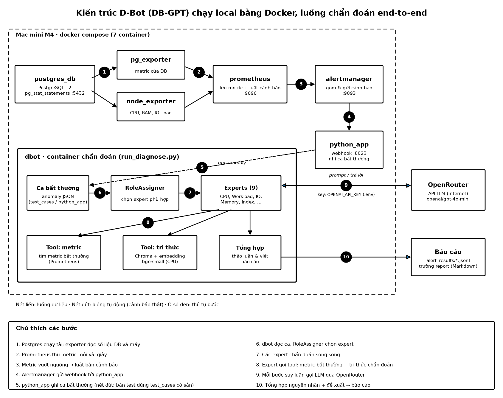
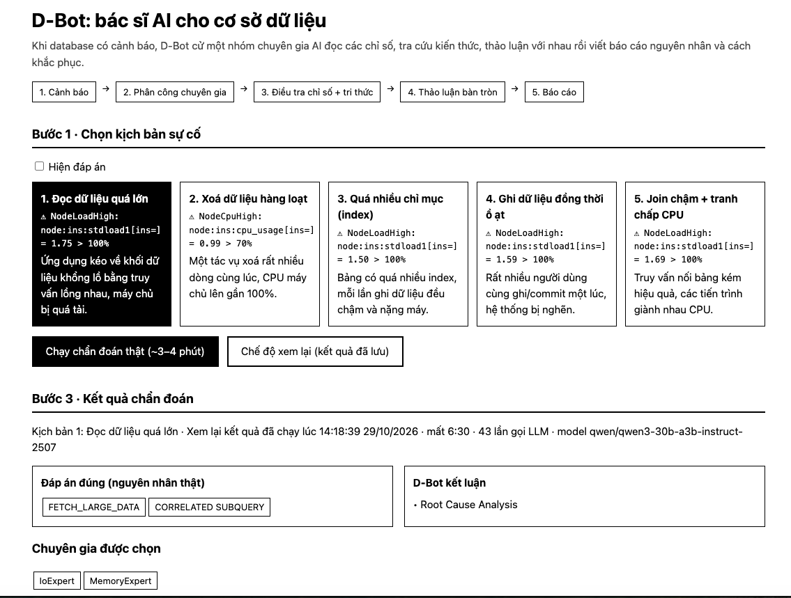

# D-Bot (DB-GPT) chạy local bằng Docker

Dùng LLM (gọi qua OpenRouter) để chẩn đoán lỗi PostgreSQL. Đã chạy thử trên Mac mini M4.



Bản PDF: [docs/DBGPT_architecture_vi.pdf](docs/DBGPT_architecture_vi.pdf)

## Setup xong sẽ thấy gì

Mở http://localhost:8080: chọn kịch bản, bấm chạy (hoặc xem lại), xem kết luận và báo cáo của D-Bot.



## Chạy nhanh

```bash
cp .env.example .env        # điền OPENAI_API_KEY = key OpenRouter
docker compose up -d --build
docker compose exec dbot python run_diagnose.py --anomaly_file test_cases/testing_cases_1.json
```

## Hướng dẫn từng bước cho người mới

1. **Cài Docker Desktop** rồi mở app lên. Đợi đến khi biểu tượng cá voi báo "running".
2. **Lấy key OpenRouter** tại https://openrouter.ai/keys. Nạp vài USD vào tài khoản.
3. **Tải code về:**
   ```bash
   git clone https://github.com/nguyenlytruongsonex1-ops/DB-GPT.git && cd DB-GPT
   ```
4. **Tạo file `.env`:** chạy `cp .env.example .env`, mở file ra và thay `sk-or-xxxx` bằng key của bạn. Không commit file này lên git.
5. **Build và chạy:** `docker compose up -d --build`. Lần đầu mất khoảng 10 đến 20 phút.
6. **Kiểm tra:** `docker compose ps`. Cả 8 service đều phải ở trạng thái `Up`.
7. **Chẩn đoán thử:** chạy lệnh thứ 3 ở mục trên, mất khoảng 3 đến 4 phút. Thấy dòng `Diagnose Finished!` là xong.
8. **Xem báo cáo:** mở file mới nhất trong `alert_results/GPT4-0613/`. Trường `report` là báo cáo dạng Markdown.
9. **Tắt:** `docker compose down`.

## Các service

| Service | Cổng | Vai trò | Cách dùng |
|---|---|---|---|
| `postgres_db` | 5432 | PostgreSQL 12 cần chẩn đoán, có bật `pg_stat_statements` | Kết nối bằng `psql -h localhost -U test sysbench`, mật khẩu `Test123_456` |
| `node_exporter` | 9100 | Đo CPU, RAM, IO, load của máy | http://localhost:9100/metrics |
| `pg_exporter` | 9187 | Đo số liệu của DB: kết nối, lock, query… | http://localhost:9187/metrics |
| `prometheus` | 9090 | Thu metric từ 2 exporter, áp luật cảnh báo | http://localhost:9090: mục Graph để vẽ metric, Status → Targets để kiểm tra exporter, Alerts để xem cảnh báo |
| `alertmanager` | 9093 | Gom cảnh báo rồi gửi webhook | http://localhost:9093 để xem cảnh báo đang bật |
| `python_app` | 8023 | Nhận webhook từ Alertmanager và ghi lại ca bất thường | Chạy ngầm, xem log bằng `docker compose logs -f python_app` |
| `demo` | 8080 | Trang web demo: chọn kịch bản, chạy, xem kết quả | Mở http://localhost:8080 |
| `dbot` | — | D-Bot: chọn expert, gọi tool và LLM, viết báo cáo | `docker compose exec dbot python run_diagnose.py --anomaly_file <file>` |

**Các ca mẫu:** từ `test_cases/testing_cases_1.json` đến `testing_cases_5.json`. Mỗi file là một ca bất thường đã có sẵn metric.

**Luật cảnh báo:** `prometheus_service_docker/node_rules.yml` và `pgsql_rules.yml`.

## Chạy kịch bản chẩn đoán

Có 5 ca mẫu trong thư mục `test_cases/`. Mỗi ca có sẵn cảnh báo, metric và đáp án đúng (trường `labels`).

| Ca | Cảnh báo | Nguyên nhân thật |
|---|---|---|
| 1 | Load cao | Đọc dữ liệu lớn, subquery lồng |
| 2 | CPU cao | Xóa dữ liệu hàng loạt |
| 3 | Load cao | Quá nhiều index |
| 4 | Load cao | Commit hoặc insert đồng thời nhiều |
| 5 | Load cao | Join kém, tranh chấp CPU |

**1. Chạy một ca** (ví dụ ca 3):
```bash
docker compose exec dbot python run_diagnose.py --anomaly_file test_cases/testing_cases_3.json
```

**2. Chạy cả 5 ca** (khoảng 20 phút):
```bash
for i in 1 2 3 4 5; do docker compose exec -T dbot python run_diagnose.py --anomaly_file test_cases/testing_cases_$i.json; done
```

**3. Xem báo cáo mới nhất:**
```bash
f=$(ls -t alert_results/GPT4-0613/*.jsonl | head -1)
python3 -c "import json,sys;print(json.load(open(sys.argv[1]))['report'])" "$f"
```

**4. So với đáp án:**
```bash
python3 -c "import json;print(json.load(open('test_cases/testing_cases_3.json'))['labels'])"
```
Đọc phần **Root Cause** trong báo cáo. Nếu khớp với `labels` thì D-Bot chẩn đoán đúng.

**5. Theo dõi khi đang chạy:** mở terminal khác và chạy `docker compose logs -f dbot`. Trong log sẽ thấy expert nào được chọn, tool nào được gọi. Nếu thấy `HTTP 200` là LLM đang trả lời bình thường.

**6. Tự tạo ca mới:** copy một file trong `test_cases/`, sửa phần `alerts` (tên cảnh báo, thời gian) và `labels`, rồi chạy với `--anomaly_file`.

## Trang demo

Mở **http://localhost:8080** sau khi `docker compose up -d` (service `demo`).

1. Chọn 1 trong 5 kịch bản sự cố (tick **Hiện đáp án** để xem nguyên nhân thật).
2. **Chạy chẩn đoán thật**: gọi OpenRouter, khoảng 3–4 phút, có thanh tiến độ và nhật ký từng bước (chuyên gia nào, dùng công cụ gì, số lần gọi LLM). Mỗi lúc chỉ chạy 1 lượt.
3. **Chế độ xem lại**: hiện ngay kết quả đã lưu trong `demo_results/`, không cần chờ, không cần key. Mỗi lần chạy thật thành công sẽ ghi đè kết quả lưu. Bản xem lại hiện dùng `qwen/qwen3-30b-a3b-instruct-2507`; các bản so sánh nằm trong `demo_results/<model>/`. Ngưỡng tra tri thức: biến `KB_SCORE_THRESHOLD` (mặc định 0.55).

Kết quả gồm: đáp án đúng so với kết luận của D-Bot, chuyên gia được chọn, biểu đồ chỉ số bất thường và báo cáo đầy đủ. Mã nguồn: `demo/app.py`, `demo/index.html`.

**Lịch sử báo cáo**: bảng mọi kết quả đã lưu (`demo_results/` + `alert_results/`), lọc theo model, bấm một dòng để mở. Màn kết quả có thêm **dòng thời gian hội thoại** từng chuyên gia, **thảo luận bàn tròn** (bấm để mở rộng) và **biểu đồ topMetrics** (SVG, chạy offline). Không tốn tiền OpenRouter.

**Log trực tiếp + nút Dừng**: khi chạy thật, khung đen hiện log của `run_diagnose.py`; bấm **■ Dừng** để kill cả nhóm tiến trình, rồi chạy lại được ngay. **JSON cảnh báo đầu vào**: bấm mở ở Bước 1 và màn kết quả. **Tài liệu tri thức đã dùng**: bảng các tài liệu D-Bot lấy từ kho tri thức (lần chạy mới có điểm số; bản cũ trích từ tin nhắn chuyên gia).

## Đổi model

Sửa `LLM_MODEL` trong `.env`, mặc định là `openai/gpt-4o-mini`, rồi chạy `docker compose up -d`. Nên dùng model mạnh vì prompt gốc viết cho GPT-4.

## Lỗi hay gặp

- **Chẩn đoán chạy mãi không xong:** xem log, nếu có `401` thì key sai. Kiểm tra `OPENAI_API_KEY`.
- **`Cannot connect to the Docker daemon`:** Docker Desktop chưa bật.
- **Build lỗi ở `pip install`:** kiểm tra mạng rồi chạy lại `docker compose build`.
- **Xem log một service:** `docker compose logs -f <service>`.

## Giới hạn

- Các ca mẫu dùng metric có sẵn trong file. Luồng tự động từ cảnh báo thật đến chẩn đoán chưa được nối hoàn chỉnh.
- Chưa có giao diện web, hiện chỉ chạy qua dòng lệnh.
